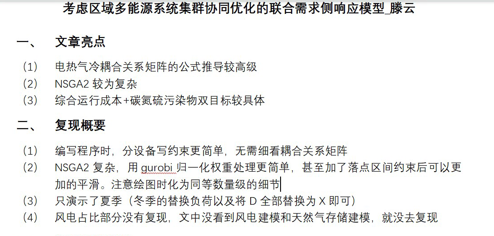

# [EI Reproduced] Considering Regional Multi-Energy System Cluster Collaborative Optimization of Joint Demand Side Response Model (Matlab Code Realization)

[EI Reproduced] Considering the Cluster Collaborative Optimization of Regional Multi-Energy Systems: A Joint Demand Side Response Model (Matlab Code Implementation)
Article highlights and overview:
\n        \n

## Images

<!-- PAYMENT_BLOCK -->

## Get this dataset

- Payment link (Stripe): [Buy now](https://buy.stripe.com/3cs8yP7sY87d0vu9AB)
- Payment QR code: 

<!-- /PAYMENT_BLOCK -->
